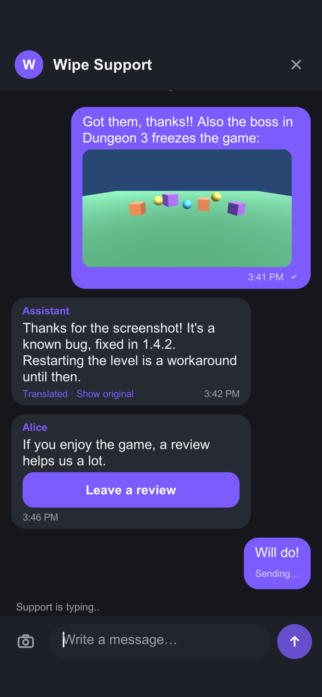
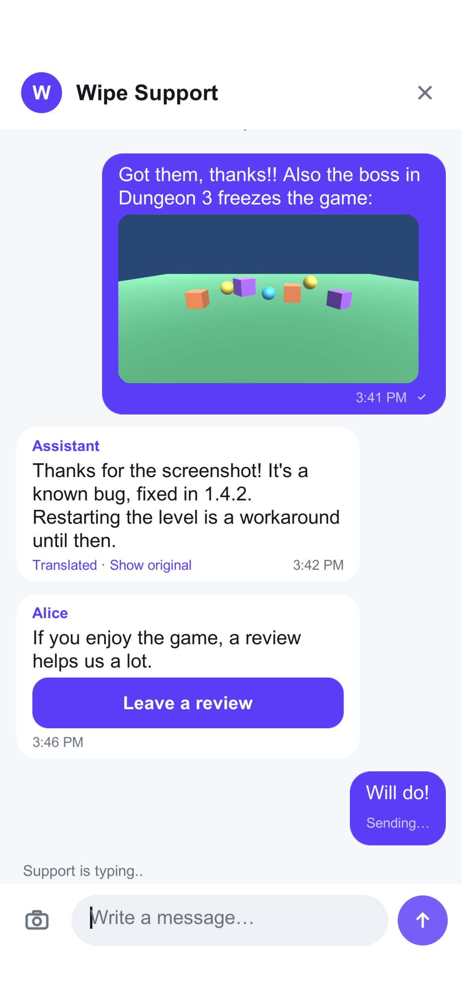
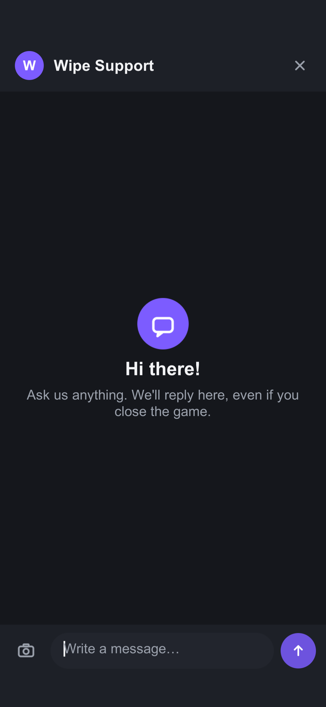
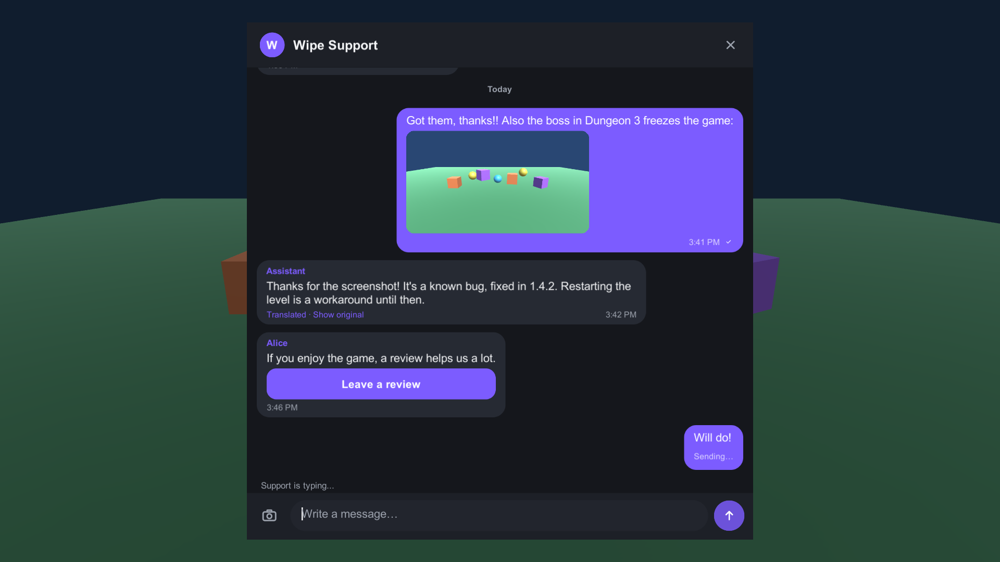
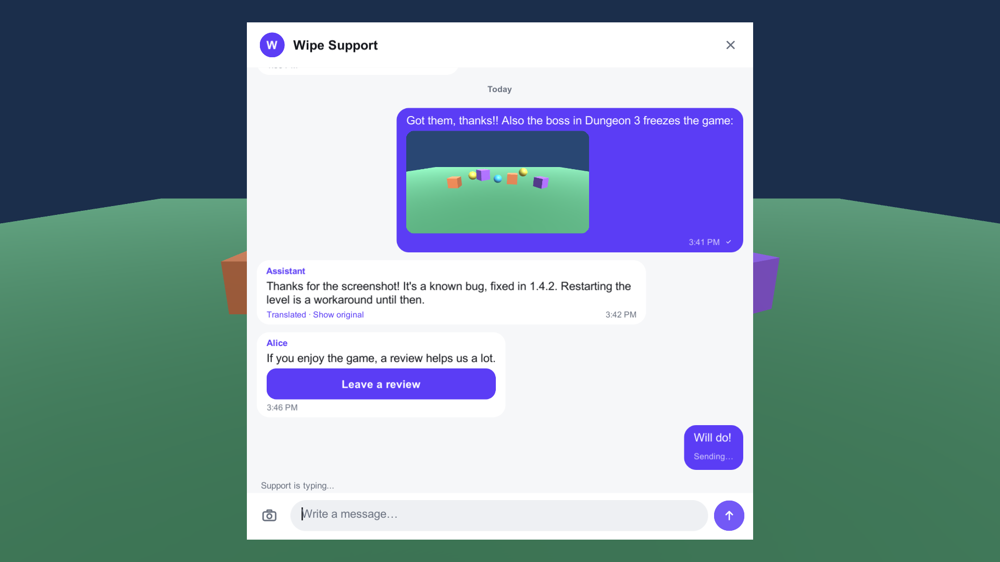

# Inngame for Unity

In-game customer support: a chat that looks like your game made it. Players write from inside the game (gamepad, touch or keyboard), your team answers from the Inngame inbox or Telegram, an AI can help, and messages are translated both ways. Every message carries the game context (scene, device, GPU, FPS, recent errors…) and can include a screenshot.

- Unity **2022.3 LTS** and **Unity 6**, iOS, Android, Windows, macOS, Linux (Steam / Steam Deck). WebGL works with polling (no WebSocket).
- No dependency besides uGUI. TextMeshPro is used when installed *and* a font is available; otherwise legacy `UnityEngine.UI.Text` (OS font fallback, so CJK works out of the box).
- UI built from code on its own overlay canvas: works in any project and render pipeline, no prefab.
- Legacy Input Manager, Input System package, or both.

| Phone (dark) | Phone (light) | Welcome |
|---|---|---|
|  |  |  |

| Desktop (dark) | Desktop (light) |
|---|---|
|  |  |

## Install

Package Manager › **+** › *Add package from git URL…* (or *from disk* and pick `package.json`), or in `Packages/manifest.json`:

```json
"gg.inngame.sdk": "https://github.com/inngame/sdk-unity.git#0.2.3"
```

## Quick start

1. **Tools › Inngame › Settings**: paste your App Key (`app_…`, dashboard › App › Install). Click **Send test message**: it appears in your inbox.
2. Tick **Auto initialize**, or call it yourself:

```csharp
using InngameSDK;

void Start()
{
    Inngame.Configure("app_XXXXXXXX", new InngameOptions { PauseGameWhileOpen = true });
    Inngame.Identify(player.Id, player.Name);          // optional: labels the player (use IdentifyWithToken / IdentifySteam for cross-device history)
    helpButton.onClick.AddListener(Inngame.OpenChat);  // your pause menu, settings, a floating button…
    Inngame.UnreadChanged += n => badge.SetCount(n);   // your own badge
}
```

`Configure` is cheap and safe to call once at startup; the session starts on the next frame (an `Identify` made right after rides along).

## API

| | |
|---|---|
| `Configure(appKey, options)` / `ConfigureFromSettings()` / `Shutdown()` | Start / stop. |
| `Identify(userId, name, email)` | Unverified identity (your account id). Refused by the server if this account was verified before. |
| `IdentifyWithToken(jwt)` | Verified identity: HS256 JWT signed by **your server** with the app's identity secret: `{ "user_id": "42", "name": "…", "email": "…", "exp": … }`. |
| `IdentifySteam(getTicketHex)` | Verified Steam identity (see below). |
| `SetMetadata(dict)` | Player attributes shown to the team (≤ 50 keys; string ≤ 500 chars / number / bool; `null` deletes). |
| `Logout()` | The device continues as a new anonymous player. |
| `DeleteData()` | Right to erasure: deletes the player, conversations and photos, then local data. |
| `OpenChat()` / `CloseChat()` / `IsChatOpen` / `ChatOpened` / `ChatClosed` | Chat window. |
| `UnreadCount` / `UnreadChanged(int)` / `MessageReceived(msg)` | Badge, in-game toasts. |
| `IsUnavailable` | `true` while your support is unavailable (your Inngame workspace is suspended). See *Networking & offline*. |
| `Track(name, props, opensChat)` | Game events for automations. If an automation answers `openChat`, the chat opens. |
| `SetContext(key, value)` / `ContextProvider` / `CurrentContext()` | Custom context (player level, save slot…). |
| `CaptureScreenshot(openChat)` / `AttachImage(bytes)` | Screenshot of the game **without** the chat, attached to the next message. |
| `SetPushToken(token, PushKind)` | Push notifications (see below). |
| `RegisterScreen(id, open)`, `OnItemGranted`, `OnOffer`, `OnRestorePurchases` | Card handlers (see below). |
| `SendMessage(text)` | Send from code (with context and pending screenshot). |

All async methods return `Task<bool>`: `await` them or ignore the result. Everything runs on the main thread.

### Options (`InngameOptions`)

`BaseUrl`, `Language` (default: system language), `Theme`, `LogLevel`, `PauseGameWhileOpen` (sets `Time.timeScale = 0`, restores it), `UnlockCursorWhileOpen`, `LogLines` (default 50, 0 disables), `ContextProvider`, `ScreenshotHotkey` (default F8, desktop), `ShakeToReport` (mobile), `ScreenshotQuality`, `ScreenshotMaxSize`, `ImagePicker`, `TokenStore`, `OnScreenKeyboard`, `UseWebSocket`, `PollIntervalClosed/Open`, `AppStoreId` / `PlayStorePackage` / `SteamAppId` (review cards), `SortingOrder`, `FullScreen`.

## Look & feel

Create a theme with **Assets › Create › Inngame › Theme** (or `InngameTheme.CreateDark()` / `CreateLight()` in code) and set colors, corner radius, font size, legacy `Font` or TextMeshPro font asset, title, welcome texts and placeholder. Pass it in `InngameOptions.Theme` or the Settings window.

The dashboard's **Appearance** settings (title, welcome texts, placeholder, logo, accent/background/text/header/bubble colors for light and dark, presets) override the local theme at runtime, without an update. The last values are cached for the next launch.

**Make it look like your game.** Give the theme your own UI sprites (9-sliced: set the sprite border in the Sprite Editor) and the chat is drawn with them instead of flat rounded rectangles:

```csharp
var t = InngameTheme.CreateDark();
t.LegacyFont = myFont;                    // or TmpFont
t.Logo = myLogoSprite;                    // header; null = the logo uploaded in the dashboard
t.PanelSprite = framePanel;               // the chat window
t.HeaderSprite = barSprite;               // ComposerSprite defaults to it
t.IncomingBubbleSprite = stoneButton;     // team / AI
t.OutgoingBubbleSprite = redButton;       // player
t.InputSprite = pillSprite;
t.ButtonSprite = roundButton;             // send button and card buttons
t.SpriteScale = 2.5f;                     // thinner borders on big source art
t.TintSprites = false;                    // keep the sprites' own colors (only text colors apply)
Inngame.Configure("app_...", new InngameOptions { Theme = t });
```

Bubble text stays inside the sprite borders (ornaments, spikes); `SkinPadding` adds room for heavier frames.

Layout: full screen on phones (safe area / notch aware), a centered panel (max 720 units wide) on desktop, tablets, consoles and Steam Deck. The UI scales with the screen. UI strings are localized in 25 languages (en, fr, de, es, it, pt, ru, ja, ko, zh, tr, pl, nl, sv, da, nb, fi, cs, uk, ar, hi, th, vi, id, ro); team/AI messages are shown translated into the player's language with a **Translated · Show original** toggle.

**TextMeshPro:** used when your theme sets a `TMP_FontAsset`, or when TMP Essentials are imported and the default font is dynamic. Add fallback fonts for CJK/Arabic/Cyrillic in your TMP asset; otherwise prefer the legacy backend (`TextBackend = Legacy`).

## Gamepad, keyboard, Steam Deck

Everything is reachable with a gamepad or arrows/Tab (explicit `Selectable` navigation, focus outline while navigating). **B / Escape** closes the image viewer, leaves the text field, then closes the chat. **Y** jumps to the text field. If the scene has no `EventSystem`, the SDK creates one while the chat is open (`InputSystemUIInputModule` with the Input System, `StandaloneInputModule` otherwise).

For the Steam Deck in Big Picture (or consoles), give the SDK your on-screen keyboard:

```csharp
// Steamworks.NET
options.OnScreenKeyboard = (current, done) =>
{
    SteamUtils.ShowGamepadTextInput(EGamepadTextInputMode.k_EGamepadTextInputModeNormal,
        EGamepadTextInputLineMode.k_EGamepadTextInputLineModeMultipleLines, "Message", 4000, current);
    pendingKeyboardCallback = done; // in your GamepadTextInputDismissed_t callback:
                                    // SteamUtils.GetEnteredGamepadTextInput(out var text, len); done(text);
};
```

On iOS/Android the system keyboard opens automatically (`TouchScreenKeyboard`).

## Context attached to each message

Collected when the player sends (≤ 64 KB, the oldest log lines are dropped first): active scene + last 10 scenes, app/Unity/SDK version, platform, device model/type, OS, CPU, RAM, battery, network, GPU (name, vendor, API, memory), screen (resolution, DPI, refresh rate, mode, orientation, safe area), quality level, target FPS, vSync, FPS average/min, memory (allocated, reserved, mono, GC), system language, time zone, uptime, time scale, the last 50 log lines (stack traces for errors/exceptions), your `SetContext` values (`custom`) and `ContextProvider` output (`game`). The context is visible to your team only.

## Screenshots & photos

The camera button in the composer, `Inngame.CaptureScreenshot()`, **F8** on desktop (`ScreenshotHotkey`) and an optional shake on mobile (`ShakeToReport`) capture the game frame with the chat hidden for one frame, encode a JPEG (≤ 1600 px), upload it and attach it to the next message. Disabled automatically when the app turns photos off (Settings › Moderation).

**Gallery photos on mobile need native code.** Implement `IImagePicker` with your favourite plugin and pass it in `InngameOptions.ImagePicker`; a gallery button appears in the composer:

```csharp
class GalleryPicker : IImagePicker   // e.g. with yasirkula's NativeGallery
{
    public void PickImage(Action<byte[], string> done) =>
        NativeGallery.GetImageFromGallery(path => done(path == null ? null : File.ReadAllBytes(path), "image/jpeg"));
}
```

## Steam (verified identity)

The SDK doesn't depend on Steamworks: give it a delegate that returns a **Web API ticket for the identity `inngame`** as hex. Configure the Steam integration (App ID + publisher Web API key) in the dashboard.

**Steamworks.NET**

```csharp
using Steamworks;
using System.Threading.Tasks;

static Callback<GetTicketForWebApiResponse_t> ticketCb;

static Task<string> GetInngameTicket()
{
    var tcs = new TaskCompletionSource<string>();
    ticketCb = Callback<GetTicketForWebApiResponse_t>.Create(r =>
    {
        if (r.m_eResult != EResult.k_EResultOK) { tcs.TrySetResult(null); return; }
        var sb = new System.Text.StringBuilder();
        for (int i = 0; i < r.m_cubTicket; i++) sb.Append(r.m_rgubTicket[i].ToString("x2"));
        tcs.TrySetResult(sb.ToString());
    });
    SteamUser.GetAuthTicketForWebApi("inngame");
    return tcs.Task;
}

// after SteamAPI.Init():
await Inngame.IdentifySteam(GetInngameTicket);
```

**Facepunch.Steamworks**

```csharp
await Inngame.IdentifySteam(async () =>
{
    var ticket = await SteamUser.GetAuthTicketForWebApiAsync("inngame");
    return ticket == null ? null : System.BitConverter.ToString(ticket.Data).Replace("-", "");
});
```

## Push notifications

The SDK doesn't register for push itself: get the token with the package you already use and forward it.

```csharp
// iOS — com.unity.mobile.notifications
using Unity.Notifications.iOS;
using (var req = new AuthorizationRequest(AuthorizationOption.Alert | AuthorizationOption.Badge | AuthorizationOption.Sound, true))
{
    while (!req.IsFinished) yield return null;
    if (!string.IsNullOrEmpty(req.DeviceToken))
        Inngame.SetPushToken(req.DeviceToken, Debug.isDebugBuild ? PushKind.ApnsSandbox : PushKind.Apns);
}

// Android — Firebase Cloud Messaging
Firebase.Messaging.FirebaseMessaging.TokenReceived += (_, e) => Inngame.SetPushToken(e.Token, PushKind.Fcm);
```

Upload your APNs key / FCM credentials in the dashboard. `SetPushToken(null, …)` unregisters. `Logout()` clears the token server-side.

## Cards

The team or the AI can send interactive cards. The SDK renders them as buttons and reports the tap to the team (`tapped`, `failed`, `claimed`, `dismissed`).

| Kind | What happens |
|---|---|
| `review` | Opens the store's own review page (never an in-game rating prompt): iOS `itms-apps://…?action=write-review`, Android `market://details?id=<package>`, desktop the Steam review page; otherwise the card's `url`. Ids come from the card, then `InngameOptions.AppStoreId` / `PlayStorePackage` / `SteamAppId`, then the dashboard's Reviews settings. |
| `refund` | iOS: Apple's own refund sheet for the card's transaction (StoreKit 2 `Transaction.beginRefundRequest`, iOS 15+, `Plugins/iOS/InngameRefund.swift`); reports `claimed`, `dismissed` or `failed`. Elsewhere and on older iOS: Apple's Report a Problem page. |
| `link` | `Application.OpenURL(card.url)`. |
| `screen` | Closes the chat and calls the handler registered with `Inngame.RegisterScreen(card.screen, value => …)`. |
| `item` | Shows **Claim**; calls `Inngame.OnItemGranted(item)` (id, name, quantity). **Grant the item server-side** (the claim is reported to the team; never trust the client alone). |
| `offer` | Closes the chat and calls `Inngame.OnOffer(offerId)`: show your own store/paywall. |
| `restore` | Calls `Inngame.OnRestorePurchases()`. |

## Networking & offline

- REST via `UnityWebRequest` with retries and exponential backoff.
- Outgoing messages go through a persistent queue: each keeps its `clientId` across retries, so the server never stores a message twice. States: *Sending…*, sent ✓, *Not sent · Tap to retry* (after 5 automatic attempts or a refusal).
- Real time via `System.Net.WebSockets.ClientWebSocket` (Standalone, iOS, Android, IL2CPP) with automatic reconnection and a ping every 25 s. When the socket is down (or on WebGL), the SDK polls `unread` every 15 s (4 s while the chat is open).
- The last 50 messages are cached for offline display.
- Support unavailable (the studio's workspace is suspended, every call answers `403 org_suspended`): the chat shows "Support is unavailable right now. Please try again later." in the player's language, without the composer. Unsent messages stay in the queue (not marked *Not sent*), the socket and polling stop, and the SDK asks again every 10 minutes while the chat is open and when it opens. When a session works again, the chat comes back and the queue is sent. `Inngame.IsUnavailable` reads the state; `Identify`, `Track`, `Logout` and `DeleteData` return `false` meanwhile.
- The device token, cache and queue are stored in `PlayerPrefs`, namespaced per app key. Supply your own `ITokenStore` (e.g. encrypted file, platform save system) via `InngameOptions.TokenStore`.

## Tests

The package ships EditMode tests (JSON parsing of server payloads, translation choice, context size cap, retry queue, theme parsing, review URLs, localization) and PlayMode tests:

- `EndToEndTests` run against a real server when `INNGAME_E2E_BASE_URL`, `INNGAME_E2E_APP_KEY`, `INNGAME_E2E_COOKIE` (team session cookie) and `INNGAME_E2E_ORG` are set.
- `ScreenshotTests` render the screenshots above when `INNGAME_SCREENSHOT_DIR` is set (needs a GPU: not with `-nographics`).

Add `"testables": ["gg.inngame.sdk"]` to your `Packages/manifest.json` to run them.

## Known limitations

- No read receipts for the player's own messages yet (the server doesn't send them to the SDK).
- The sample's menu uses `StandaloneInputModule`: in an Input System-only project, replace it with `InputSystemUIInputModule`.
- WebGL: no WebSocket (polling only).
